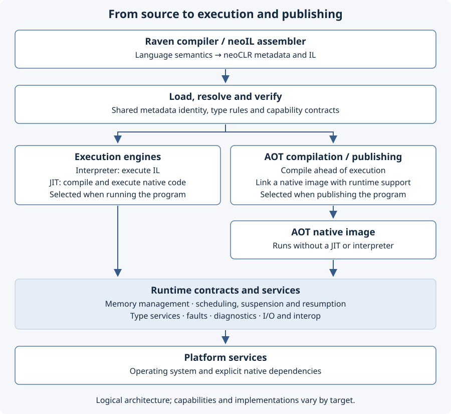
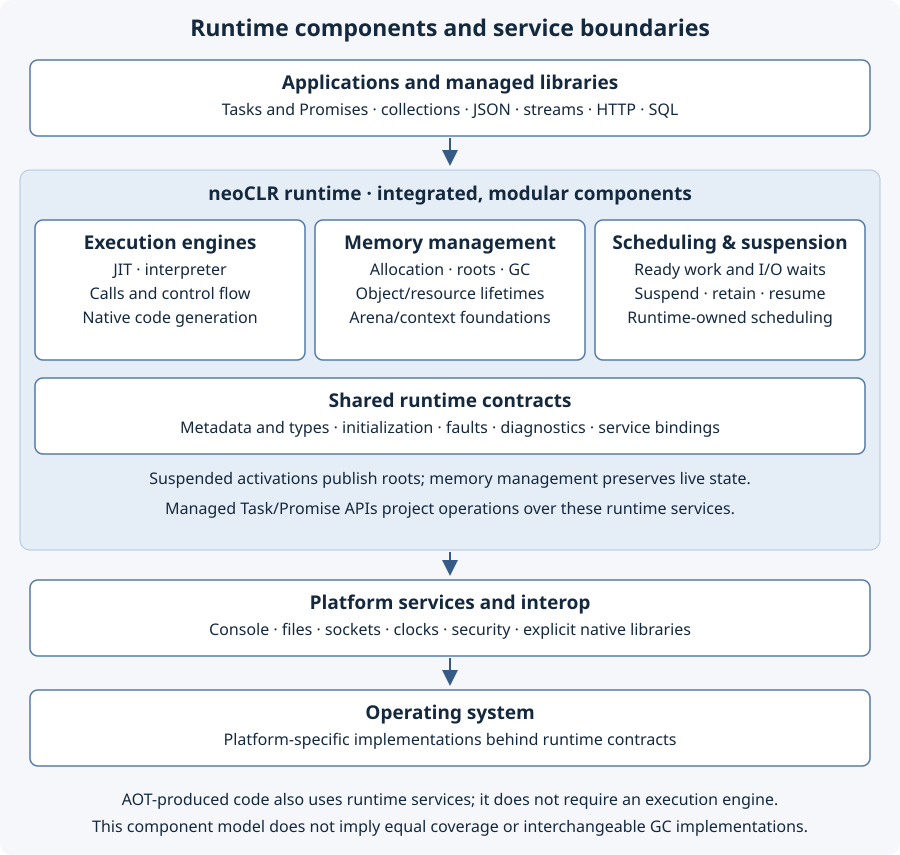

# neoCLR architecture

Current implementation overview, reviewed 2026-10-13. This describes the development
checkout, not a guarantee that every capability is in the published bundle. The
[platform roadmap](platform-roadmap.md) remains the sequencing authority.

neoCLR combines a managed runtime, a Raven class library, compiler integration and
project/editor tools. .NET supplies the ergonomic baseline: typed code, assemblies,
generics, interfaces and managed storage. neoCLR owns its execution semantics and
runtime services; it is not a replacement CLR for arbitrary .NET binaries.

## Modules organize the library

The class library and its APIs are organized into **modules that form namespaces**.
Modules are neoCLR's primary means of organizing code: each is a named container for
types, functions and constants, and its name supplies their namespace for qualified
lookup and imports. This gives code organization an explicit declaration owner rather
than relying on arbitrary namespace groupings.

For example, the `System.Runtime` assembly contains modules such as `System`,
`System.Math` and `System.Time`. Assemblies retain packaging and dependency identity;
a module need not correspond to an assembly or a separate file. See the
[Modules feature page](../website/content/features/modules/index.md) for the model,
declarations and current limits, and [declaration modules](declaration-modules.md)
for the metadata contract.

## Source and tools

Raven binds source through its compiler and selects a target-specific metadata/emission
path. The native target emits neoCLR artifacts and imports native library symbols.
The ordinary .NET target remains separate. The neoIL assembler supplies a direct path
for runtime tests and low-level programs. Its instructions are a typed runtime model,
not a claim that every operation has an ECMA CIL byte encoding.

Projects, the language server and documentation tools consume metadata alongside the
compiler. Native symbols should retain their assembly and declaration-module owners
rather than acquire invented CLR container types. The earlier bounded CLI import bridge
is a separate compatibility workflow; it does not define native semantics. See
[Raven integration](raven-cli-bridge.md) and [metadata format](metadata-format.md).

## Artifact admission and shared program state

The native reader decodes PE/#Neo or standalone NEOX into `Module`. JSON remains an
inspection/intermediate input. Container validation checks framing and encoding; it
cannot establish that an instruction body is well typed. Dependency resolution and
preparation bind references and preserve definition identity. `LoadedProgram` is the
Rust representation of the prepared metadata snapshot. Loading and typed verification
are separate operations; loading does not execute initializers or application code.

Typed verification checks the resolved instruction model before execution. An execution
owns frames, allocations, output and native-library state; an explicitly supplied host
console can share external I/O state. Metadata is not a serialization of these live
objects. These host APIs are not a stable native embedding ABI.

Implementation entry points: [container reader](../src/metadata_container.rs),
[metadata model](../src/metadata.rs), [linker](../src/library.rs),
[loaded program](../src/program.rs), [verifier](../src/verifier.rs),
[execution](../src/execution.rs).

## Execution and services

The runtime has three central component groups:

| Component | Responsibility |
| --- | --- |
| Execution engines | JIT and interpreter execute the shared program model, preserving calls, control flow and runtime contracts. |
| Memory management | Allocation, root publication, object/resource lifetime and collection. GC is the current managed policy; arena/context foundations do not yet provide interchangeable collectors. |
| Scheduling and suspension | Dispatch ready work, integrate I/O waits, suspend activations and resume them while their live state remains rooted. |

Metadata/loading, type services, initialization, faults, diagnostics and platform
service bindings support these components. Boundaries describe responsibilities,
not necessarily processes, crates or one implementation shared by every engine.
The interpreter and native code currently use different internal memory machinery.
JIT backend hosting can be in-process through the private component API, while the
installed CLI still invokes a separate eager-compilation backend process. See
[integration status](runtime-product-integration.md).

Managed `Task` represents an operation, `Promise` its producer side, and `Scheduler`
projects scheduling services. These APIs sit above the runtime's scheduling and
suspension machinery. Suspended activations must publish their roots; resumption,
collection and abandonment must preserve ownership and exactly-once cleanup.
Runtime-await is the intended default neoCLR lowering; provider/SDK integration,
library coverage and native Windows suspension qualification precede that switch.
Compiler state machines remain a supported explicit fallback. The current native
retained-stack carrier is macOS ARM64-specific, not a promise of target parity.

The Raven library builds application APIs over these contracts. An HTTP operation
uses socket adapters and OS resources while the scheduler tracks readiness and
memory management keeps live request state reachable. Text and numeric primitives
are runtime services too; a familiar `System` API need not be implemented in the VM.

The current Raven target uses copied values and reference-semantic classes and managed
arrays. Managed byrefs denote slots; unmanaged pointers belong to a separate interop
contract. Text is UTF-8, with byte, scalar and grapheme operations distinguished.
Expected application failures use library `Result` values; terminal runtime Faults
are distinct from a CLR guest exception hierarchy. See [runtime reference](reference/README.md)
and [library/runtime boundary](raven-cli-bridge.md).

## Native compilation

AOT is a **compilation and publishing target**, not a third execution engine.
The [shared native backend](../tools/aot-poc/) lowers admitted metadata/IL for both
JIT and AOT. Publishing links a native image with the runtime services it requires;
running that image needs neither the JIT compiler nor interpreter. GC, scheduling,
text, I/O and fault services still exist in the published program.

JIT and AOT are integrated product components despite historical POC directory and
binary names. Their supported profiles and workloads remain bounded; packaging does
not establish general native parity. Development JIT bundles select JIT on macOS
ARM64 and Windows x64, with explicit interpreter execution retained. See the
[execution architecture](execution-architecture.md), [integration evidence](runtime-product-integration.md)
and [roadmap](platform-roadmap.md) for target-specific status. Native hot reload,
trimming and a stable public hosting ABI remain separate work.

## Bootstrap and compatibility boundaries

The published native workflow retains explicit primitive-core/runtime bootstrap inputs.
Source-built library coverage and focused native-only core probes do not establish a
fully independent production core. Keep matching compiler, library and runtime artifacts
as documented in the [bundle procedure](native-poc-bundle.md).

Against .NET/CLR, the familiar compilation/metadata/managed-execution layers reduce the
number of concepts a developer must relearn. UTF-8 text and explicit service contracts
support neoCLR's platform choices, but require target-specific libraries and tooling.
The current transport also requires a neoCLR-aware reader. No performance advantage or
.NET binary compatibility follows from this architecture. Existing comparisons and
tradeoffs are maintained in [design research](design-research.md) and the
[extended metadata design](design/extended-cli-metadata.md).
