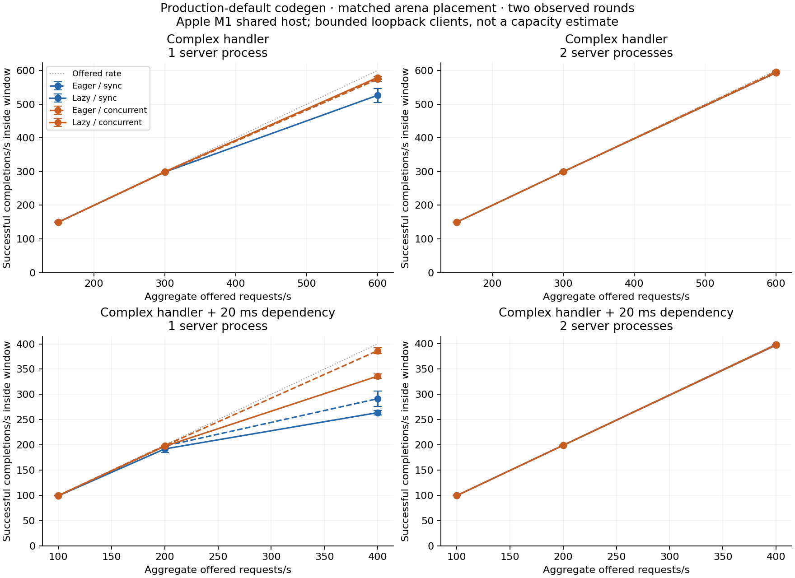
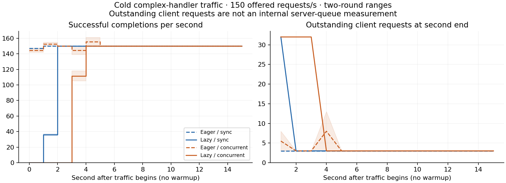

# Lazy JIT optimization and GC profiling — 2026-10-26

Author-directed follow-up to the [opt-in baseline](../lazy-jit-20261026/README.md).
Development work; eager JIT and synchronous GC remain defaults. Measurements below
use macOS ARM64 and the existing single-mutator, nonmoving-heap contract. Native
marker/I/O scheduling and concurrent connections do not establish support for
arbitrary managed threads.

## Codegen configuration correction

The retained baseline and the initial factorial/profile cohorts use the private
`NEOCLR_TEST_OPT_LEVEL=speed` override. This matters: production `backend_settings()`
retains Cranelift's default (`none`), which favors compilation time. The earlier
reports did not make this distinction prominent enough. Their raw recipes preserve
the setting and their measurements remain valid for that configuration; they are
not production-default codegen measurements. The source change does not enable
`speed` in production.

`prepare-lazy-production.py` removes only that test override. Fresh placement,
startup and production-shaped load cohorts then use production codegen defaults,
with eager-arena controls still explicitly labelled as placement controls. Do not
pool the two optimization configurations. The intermediate speed-setting rerun
under `target/lazy-jit-production-cases` was deliberately stopped after successful
HTTP and sample cohorts, before its load stages, to make this correction.

“Production-default” here qualifies the backend optimization setting only. These
remain controlled development fixtures with pinned native hosts, explicit collector
recipes and an internal persistent driver, not a published SDK deployment or a
claim that every runtime/resource option matches production defaults.

## Production-default codegen HTTP and placement qualification

These fresh runs omit `NEOCLR_TEST_OPT_LEVEL`; Cranelift uses its production
default. Each row is the median of three process launches, 4,096 measured plus
16 warmup responses per launch. All 36 trials pass (148,032 checked responses).
Eager uses its default system placement; lazy uses its new macOS ARM64 arena
policy. Explicit lazy system controls isolate the placement effect below.

| Payload / execution / GC | Ready s | First response s | Warm req/s | Warm p99 ms | Invocation CPU s |
| --- | ---: | ---: | ---: | ---: | ---: |
| plain / eager / sync | 13.436 | 0.002 | 3315.3 | 19.7 | 1.240 |
| plain / lazy / sync | 11.129 | 1.213 | 3670.5 | 48.2 | 2.660 |
| plain / eager / concurrent | 15.585 | 0.003 | 2842.3 | 25.5 | 1.453 |
| plain / lazy / concurrent | 10.206 | 2.111 | 2292.0 | 74.4 | 4.370 |
| json / eager / sync | 12.800 | 0.003 | 1936.2 | 33.4 | 2.122 |
| json / lazy / sync | 9.954 | 1.697 | 2123.1 | 54.2 | 3.953 |
| json / eager / concurrent | 15.517 | 0.003 | 1712.8 | 38.9 | 2.421 |
| json / lazy / concurrent | 10.321 | 3.083 | 1477.3 | 78.7 | 6.342 |

Invocation CPU includes cold compilation, measured traffic and collector work;
it is not warm CPU per request. The readiness gain defers some work into the first
request. The pipeline throughput comparison is not a fixed offered-load capacity
measurement. Plain sync readiness varies considerably across the three launches;
the raw ranges remain available.

| Lazy arena versus lazy system | Paired median req/s change | Range |
| --- | ---: | ---: |
| plain / sync | +28.78% | +28.49–+35.27% |
| plain / live | +22.27% | +4.53–+29.23% |
| json / sync | +28.36% | +5.22–+35.07% |
| json / live | +29.91% | +13.39–+34.06% |

Every paired placement trial improves throughput, supporting the bounded lazy
arena policy on this host. The range is descriptive, not a confidence interval;
it does not qualify other architectures. Direct binding stays test-only.

### Standalone startup with default codegen

Twenty-four invocations cover two samples, both collectors and eager/lazy execution,
with three launches per combination. Small-program startup remains mixed; a large
HTTP improvement does not imply the same benefit for short programs.

| Sample / GC | Eager median ready s | Lazy median ready s |
| --- | ---: | ---: |
| compute / sync | 2.489 | 2.465 |
| compute / live | 2.548 | 2.585 |
| steady / sync | 2.494 | 2.350 |
| steady / live | 2.605 | 2.515 |

The compute and allocation samples leave 23 selected methods uncompiled. The HTTP
plain/JSON runs compile 692/870 of 1,599 selected methods; 907/729 remain uncompiled.
Placement does not turn lazy execution into background whole-program compilation.

## Direct-binding experiment (not selected for production)

When lowering a newly requested method, replace its direct calls to already
published methods with calls to their immutable bodies. Leave cold targets and
address-taken references on stable trampolines. No unused method is lowered, no
existing executable code is rewritten, and no caller is recompiled. Every target
has already passed GC admission, frame validation, relocation and instruction-cache
publication. Original signatures and conservative combined frame checks remain.
References remain valid through host cleanup because the module owns all code.

This reuses the baseline's CoreCLR prestub/code-versioning research. neoCLR currently
has immutable, invocation-owned native bodies; introducing code replacement or
tiering would require reconsidering direct bindings. GC policy and store-check
proof requirements are unchanged. This optimization cannot recover the concurrent
collector's whole-program stack-argument guard elision.

The `boundDirectCalls` diagnostic counts rewritten call sites, not dynamic calls.
`mutatorCompilationWaitSeconds` includes channel creation, dispatch, compilation,
publication and response delivery. `longestCompilationWaitSeconds` is the longest
single resolver wait, not a request percentile. Worker compilation time is reported
separately; subtracting it from resolver time approximates handoff/wait overhead
but is not a pure OS scheduling measurement.

## Experiments

- Compare eager JIT, lazy control (`NEOCLR_TEST_LAZY_KEEP_TRAMPOLINES=1`), lazy direct
  binding, and a separate test-only arena placement variant, under both collectors.
  All variants use identical guest/native hosts and the same compiler executable.
- Keep profiling cohorts separate from uninstrumented timing trials. The retained
  baseline has eight one-second wall-stack captures. They include sleeping threads
  and must not be converted to CPU percentages.
- CPU Profiler traces and owner-thread clock instrumentation distinguish execution,
  socket polling, idle GC, root delivery and fiber scheduling where available.
- A fragmented-header workload sends the request line, waits, then sends headers.
  Multiple client connections exercise pending reads and overlapping I/O. Client
  delays are explicit and included in request latency and throughput wall time;
  results are not saturation or framework-ranking claims.

## Initial attribution

The initial factorial used a prototype in which binding was enabled unless
`NEOCLR_TEST_LAZY_KEEP_TRAMPOLINES=1` selected the control. The retained prototype
source documents that experiment. Current code defaults to no binding and exposes
only `NEOCLR_TEST_LAZY_BIND_COMPILED=1` in test builds; current preparers use that
explicit opt-in. Do not use the obsolete prototype flag to configure new runs.

The eight retained baseline wall-stack captures pass 262,272 checked responses.
In all four lazy captures, the compiler worker is waiting for a request throughout
the sampled window. Concurrent marker threads are also mostly waiting in these
short windows. Named execution frames include stack checks, GC-frame/root services,
TLS resolution and (more frequently for lazy concurrent execution) generic stores.
This agrees with the retained conservative store checks, but neither wall sampling
nor unknown generated-code addresses establishes exact CPU percentages or causality.

The raw captures and parsed named-frame/thread observations are retained alongside
this report. The corrected direct-binding implementation passes 207 compiler tests,
12 recursion/stack/unused-body cases and four injected failure/panic cleanup cases.
The first test run exposed an incorrect test assumption that declaring a Cranelift
function reference reuses its numeric ID; the test now verifies target identity.

The initial eight-mode screen is exploratory. The subsequent incomplete ten-mode
run was stopped to include eager arena controls: otherwise allocator improvements
would be confounded with lazy compilation. Neither is pooled into final medians.

## Three-round factorial results

The complete matrix has 72 successful processes and 296,064 checked responses:
12 configurations × two payloads × three alternating rounds, with 4,096 measured
requests and 16 warmups per process. System/arena placement, direct binding and GC
are varied separately. Timings are uninstrumented; all configurations share the
same compiler binary, guest and collector-specific native host. These loopback
clients do not establish saturation. Three rounds give a useful bounded comparison,
not a confidence interval or a cross-machine guarantee.

Below are medians. “Lazy system” and “lazy arena” retain all stable trampolines;
“eager arena” controls for placement independently of laziness.

| Payload / GC | Eager system ready s / req/s | Lazy system ready s / req/s | Lazy arena ready s / req/s | Eager arena req/s |
| --- | ---: | ---: | ---: | ---: |
| Plain / sync | 12.686 / 4,412 | 9.566 / 3,717 | 9.869 / 5,564 | 7,329 |
| Plain / concurrent | 15.879 / 3,748 | 10.073 / 2,480 | 9.873 / 3,401 | 5,421 |
| JSON / sync | 12.583 / 2,533 | 9.706 / 2,136 | 9.724 / 3,089 | 3,797 |
| JSON / concurrent | 15.324 / 2,264 | 9.956 / 1,328 | 9.982 / 1,816 | 3,221 |

Moving lazy compilation to a bounded arena improves the **median of paired-round
throughput changes** by 42.85% (plain/sync), 37.11% (plain/concurrent), 42.99%
(JSON/sync) and 36.74% (JSON/concurrent). Every paired round is positive; the full
range across these comparisons is +34.43% to +49.67%. These paired percentages are
not ratios of the independently calculated medians in the table. Eager compilation
also benefits from arena placement; this is not a benefit unique to laziness.

In contrast, direct binding on the same arena has paired medians of +0.64%, +1.10%,
+0.35% and −1.25%, respectively. JSON/concurrent ranges from −30.72% to +8.29%;
that outlier remains in the report. This does not justify enabling direct binding
in production. Rewritten static call-site counts do not describe hot dynamic
coverage. Stable trampolines still carry a frame and indirect call when warm.

Lazy arena first-response medians remain 1.219/2.219 seconds for plain sync/concurrent
and 1.745/3.213 seconds for JSON. Readiness alone therefore overstates the cold-user
benefit. Across these HTTP cases, 692 or 870 methods are compiled, leaving 907 or
729 of 1,599 selected methods uncompiled. Worker compilation dominates the resolver
wait; the difference is normally only about 7–12 ms over an invocation. Moving the
same work onto another worker does not remove the first-call stall.

## Overlapping I/O and scheduling

A separate three-round JSON cohort uses 16 connections, 1,024 measured requests,
16 warmups and a 20 ms gap between each request line and its headers. All four
configurations use the same arena policy. The deliberate wait is included in wall
time and request latency. These are bounded server tasks and native I/O/marker
threads, not arbitrary managed mutators.

| Execution / GC | Median ready s | Median req/s | Median client p99 ms | Median invocation CPU s |
| --- | ---: | ---: | ---: | ---: |
| Eager / sync | 12.948 | 561.0 | 35.1 | 0.835 |
| Eager / concurrent | 15.788 | 580.7 | 34.0 | 0.975 |
| Lazy / sync | 10.116 | 555.2 | 37.2 | 3.009 |
| Lazy / concurrent | 9.978 | 512.5 | 52.6 | 5.000 |

I/O slack narrows the throughput gap, and eager concurrent GC is slightly faster
here. Lazy concurrent GC still loses to lazy sync, including tail latency and CPU.
Invocation CPU includes cold compilation and cleanup; it is not steady-state CPU.
A separately instrumented scheduler cohort passes its phase-accounting checks.
In ordinary pipelined JSON, poll CPU is approximately 35–39 ms in all four cases;
idle-GC CPU is below 1 ms. These observations do not identify a lazy-specific poll
bottleneck. In the fragmented-I/O diagnostic, idle-GC owner CPU rises to roughly
107–120 ms for sync and 210–244 ms for concurrent execution, while poll CPU stays
around 37–41 ms. Scheduler waits are approximately 1.25–1.38 seconds of wall time
but only 14–16 ms of owner CPU; waiting is not active CPU consumption. Counts vary
with scheduling. Conservative concurrent-GC stores remain a known difference.

## Memory and profiling boundaries

Whole-process snapshots after traffic put lazy system/arena RSS within about
0.3 MB in each collector comparison (roughly 978 MB sync and 1,025 MB concurrent).
The arena reserves about 64 MiB of virtual address space; this does not imply 64 MiB
of additional physical memory on this host. These are snapshots, not peaks or
managed-heap measurements. Native allocation zones retain substantial address space
after compiler structures are freed. Windows reservation/commit behavior has not
been measured by this experiment.

CPU Profiler tables use sampled cycle weights, unlike the wall-stack captures.
In the ten-second lazy/sync startup capture, `linking::prepare` occurs in 84.1% of
sampled cycles, selection in 49.2% (inclusive) and `Module::type_definition` in 19.8%
(self). The compiler worker accounts for 15.5% of captured cycles. These nested
percentages must not be added. The shorter wall captures emphasize resolving,
cloning and allocation; they are not evidence that those costs dominate the entire
startup. The CPU capture supports profiling metadata lookup/selection next without
skipping verification or precompiling unused bodies.

The warm JSON CPU captures resolve a concrete concurrent-GC difference:
`experiment_gc_store` accounts for 17.5% of captured cycles in lazy concurrent
execution versus 4.8% eager concurrent, and TLS lookup 20.2% versus 15.1%.
The compiler worker receives no CPU samples in these warm captures; the marker
has only 0.02–0.03% of sampled cycles. This short workload is dominated by mutator
work, not an actively competing compiler. Unknown generated frames remain in the
export; sampling is not an exact instruction accounting or proof of causality.

## Retained objects with overlapping I/O

The additional compiled Raven fixture keeps 4,096 `Person` instances, replaces one
slot per request and verifies every surviving ID and cursor at shutdown. It uses
the same checked wire payload and fragmented-header parameters as the previous
cohort. Twelve processes pass 12,480 responses. Peak live bytes increase to roughly
395 KB sync / 448 KB concurrent. This tests a larger live set, not general managed
thread support or a production-sized service.

| Execution / GC | Median ready s | First response s | Median req/s | Median p99 ms | Invocation CPU s |
| --- | ---: | ---: | ---: | ---: | ---: |
| Eager / sync | 13.149 | 0.027 | 488.9 | 45.4 | 1.433 |
| Eager / concurrent | 15.630 | 0.024 | 582.4 | 32.6 | 1.579 |
| Lazy / sync | 9.986 | 1.748 | 452.8 | 44.6 | 3.607 |
| Lazy / concurrent | 9.933 | 3.171 | 501.8 | 50.6 | 5.553 |

Concurrent versus sync lazy throughput improves in all three paired rounds:
+3.58%, +10.81% and +13.86% (median +10.81%). Its p99 is 10.10–22.66% worse and
invocation CPU 52.50–54.03% higher. Eager concurrent also benefits, so this is a
workload-dependent GC advantage rather than evidence of a unique lazy/GC synergy.
Keep both the positive throughput result and its latency/CPU costs visible.

## Production-shaped load investigation (author follow-up)

The author subsequently requested typical production-shaped cases, multiple apps
sharing resources and complex handlers, with a situational summary of advantages.
The added open-loop harness reuses `benchmarks/http-server/load/run.py`'s fixed
arrival scheduler. Arrivals are not slowed to match server completions; a bounded
client in-flight limit records missed arrivals rather than hiding a queue. Response
bodies/framing are checked, and server totals are reconciled when all admitted
requests succeed. Report successful completions inside the offered window, drain,
per-app p99, dispatch lag, CPU and RSS. A target of 100 ms p99, no missed/failed
offered requests and at most 5 ms generator p99 lag is an experimental reporting
criterion, not a product SLO.

Latency percentiles describe successful requests and include dispatch delay. A
missed arrival has no response latency, so low p99 under substantial admission loss
is not evidence of good service. Read tails together with the successful fraction,
within-window completion rate and generator lag. Outstanding-request timelines
measure client requests, not the server's internal queue. Resource samples bracket
traffic and drain; they exclude startup and are not peak RSS or allocation counts.

Cases add nested JSON parsing/validation/serialization, 32 temporary records and
512 checked calculation steps per handler to the retained 4,096-object window.
An async-handler variant awaits a checked local socket dependency with a controlled
20 ms response delay before processing. This models downstream waiting, not a real
database or external network. One or two isolated server processes share the Apple
M1's eight physical/logical CPUs and 16 GiB RAM. Each server is configured for 32
connections and 16 handlers. Client in-flight limits are explicit; no CPU affinity,
hard memory quota, container isolation or general managed-thread support is implied.
Cold runs omit warmup so first-call blocking is exposed to offered traffic.

Several completed complex-handler trials have generator p99 lag above 5 ms. A
single process snapshot during the following service cohort observes macOS
`mediaanalysisd` above one CPU core and WindowServer activity; it cannot attribute
all earlier variation, but confirms the host was not isolated. No unrelated
processes were stopped. Retain those trials and the strict target failures;
repeat on an isolated host with a separate generator before capacity/default claims.

The first dependency fixture read its URL from the environment and failed JIT
selection with `unsupported value member contract` before readiness. The failed
output and source are retained. A second HttpClient-based fixture is rejected by concurrent GC's unaudited-native-body
admission check. Its initial sync runs also did not call the dependency because
request header names were normalized; dependency call accounting now prevents
that silent workload mismatch. These attempts are excluded from performance
comparisons. The narrower fixture passes a port through a checked header and
awaits socket connect/send/receive with a one-byte request/response contract.
Neither workaround claims a runtime fix for the rejected contracts, and no GC
admission check is disabled. All fixture syntax is compiled with the pinned Raven bridge.

The socket variant then exposed a real generated-wrapper defect: selecting the
single-address `SocketConnect` native replacement did not create the live-store
frame required for checked result publication. The fix adds that method to the
GC-boundary plan and to the exact single-address provider admission list. The
provider copies IPv4 address data into native operation storage, retains the
callback through `neoclr_gc_host_root_create_v1`, and uses the existing socket
completion/cancellation root lifecycle. It does not retain a borrowed managed
address string or access managed objects from a new worker. Existing host capability
checks, publication checks and cleanup remain required. The compiler regression
fixture covers both store modes; native awaited consumers qualify both collectors
and eager/lazy execution. DNS and multi-address providers are not admitted by this
change. The earlier `Int32.Parse` replacement is also outside the live audit; the
private port protocol uses an explicitly checked 1–5 ASCII-digit range instead.

This preserves .NET-style asynchronous socket completion at the public API level,
while neoCLR's implementation retains its documented single-mutator/nonmoving
contract. It is not a new public API, a claim of broad HttpClient concurrent-GC
support, or permission to skip native-provider auditing.

The completed complex-handler cohort contains 48 rate windows. At 600 offered requests/s with one app, lazy concurrent has median 579.2 within-window completions/s versus lazy sync 526.3; successful offered fractions are 96.79% and 88.23%. Median worst-app p99 is 100.6 versus 111.1 ms, and traffic/drain CPU is 10.44 versus 9.75 seconds. Both fail the strict target, with substantial generator lag. Two apps bring both lazy variants to roughly 593 completions/s at that aggregate rate, but tails and lag remain unqualified. These are useful exploratory pressure signals, not a capacity result.

The 48-window awaited-dependency cohort also completes. At 400 offered requests/s with two apps, lazy concurrent meets the strict target in both rounds: median 398.3 within-window completions/s, 100% eventual offered success, worst-app p99 51.1 ms and generator p99 0.7 ms. Lazy sync records 397.4 completions/s, 99.75% success and 107.3 ms worst-app p99, failing the target. Aggregate traffic/drain CPU is 18.62 versus 13.13 seconds (+41.8%). This is a measured latency/loss benefit at greater CPU cost. Eager sync also passes this point with lower CPU, so it is not evidence that lazy concurrent already dominates all modes. Lower-rate failures elsewhere are non-monotonic and reinforce the shared-host qualification limit.

With one app at 400/s, lazy concurrent completes 336.0/s versus lazy sync 263.8/s, but both lose arrivals and fail the target. Do not turn that throughput ratio into a capacity recommendation.

The eight cold windows complete with clean shutdown. At 150 offered requests/s for 15 seconds, eager sync/concurrent each have 100% eventual success and median 149.8 within-window completions/s. Lazy sync records 88.40% success and 132.4/s; lazy concurrent 78.42% and 117.4/s. Traffic begins after READY, so these windows expose deferred work separately from process launch; readiness itself is measured elsewhere. Concurrent-lazy has zero successful completions in each of the first three seconds, then recovers to the offered rate after compilation.

The 16 uneven-load windows also complete. With two apps receiving 90/10 of 300 offered requests/s, lazy sync passes both rounds (100% success, 26.5 ms median worst-app p99, 8.89 seconds CPU), while lazy concurrent fails (99.77%, 90.3 ms, 14.16 seconds CPU). At 600/s both fail: median completions are 580.5/s sync and 585.0/s concurrent, while worst-app p99 is 81.7 versus 130.4 ms. The light app completes every offered request, but its concurrent second-round p99 reaches 169.4 ms. This is no clear concurrency win for the uneven compute-heavy mix; per-app tails matter even without losses.

Ordinary-request controls send the complete request in one write without the deliberate header delay. In the completed complex-handler control at 600/s, lazy concurrent records median 587.7 completions/s versus sync 567.0/s, but the direction reverses between rounds, and both miss arrivals. At 150/s, concurrent passes both rounds with 4.5 ms median p99 and 10.04 seconds traffic/drain CPU; sync has 31.1 ms p99 and 6.85 seconds CPU, with one generator-lag failure. This supports keeping the artificial-delay dimension explicit rather than claiming a robust compute-throughput win.

The cold concurrent-lazy runs each time out the first 32 client requests at the
three-second deadline; those timeouts are not included in successful-response p99.
This directly exposes cold-call blocking, but does not prove that yielding alone
will fix it: when every request needs the same cold method, they still need an
executable implementation. Faster compilation or a fast initial execution tier
addresses that delay; the proposed mixed warm/cold-route case measures whether
suspension preserves independent useful progress.

The author-requested [benchmark and TechEmpower review](../../../benchmarks/gc-suite/workload-review-20261026.md) records coverage, configuration corrections, rerun decisions and remaining production-workload gaps.

## Processing continuity and next boundaries

The author explicitly retains lazy JIT plus concurrent GC as the intended future
direction where it yields useful gains. This report directs optimization toward
the costs preventing that outcome; today's fastest configuration is not by itself
a long-term design decision. Sync remains the comparison and a situational option.
Default changes require demonstrated benefit and correctness qualification. The long-term selection criterion is usefulness across the broadest workload set, including resource and latency constraints, rather than maximizing one benchmark.

The author's objective is less blocking and more evenly distributed runtime work.
The selected placement policy reduces execution cost but does **not** make the
first-call resolver nonblocking. `recv()` still stalls the sole managed execution
thread; the compiler and marker can run, but other ready managed fibers cannot
progress during that wait. A safe follow-up needs a scheduler-owned suspended-call
contract (arguments/roots, completion wakeup, failure and teardown), or a compatible
interpreter/quick tier. An arbitrary callback pump or compiling all unused bodies
in the background would not meet that objective. Pair cold concurrent requests,
per-request stalls and warm throughput under both collectors when implementing it.
Metadata lookup/selection is the separately measured startup target.

### Ordinary downstream I/O confirmation

With a complete request sent in one write and a 20 ms downstream wait, the
15-second, 400/s lazy comparison again favors concurrent completion rate: median
360.4/s versus sync 292.5/s. Eventual success is 90.45% versus 73.58%, successful
p99 94.7 versus 152.3 ms, and traffic/drain CPU 14.68 versus 12.17 seconds. Both
lose arrivals and fail the strict target; concurrent improves both rounds, but
this is an overload comparison, not a passing capacity point. At 100/s concurrent
passes both rounds, while sync has one generator-lag/tail failure. The I/O benefit
does not depend solely on artificial request-header delay.

### Load curves and complete results

[All load points, ranges and per-app boundaries](load-results.md) retain the less
favorable cases as well as the gains. The shaded cold timelines are two observed
rounds, not confidence intervals. The first three concurrent-lazy seconds have
no successful responses; later steady behavior does not erase those initial losses.

### Optimization potential, rather than today's winner

The provisional largest-headroom candidate is **lazy JIT with concurrent GC**.
It combines avoidable first-call blocking with costs exposed by the live collector's
conservative checks. That creates opportunities, not a guarantee that removing them
will beat sync on every workload. Captured CPU shares are not promised speedups.

| Candidate | Evidence and expected reach | Boundary to validate |
| --- | --- | --- |
| Suspend a cold caller while unrelated ready work progresses | Resolver waits block the only managed execution thread; relevant to cold routes and traffic arriving during warmup | Published arguments/roots, completion wakeup, once-only compilation, failure/cancellation and teardown; measure warm-route progress during cold-route compilation |
| Recover sound local store-check proofs | In the separate `speed` CPU capture, lazy concurrent generic-store self cycles are 17.5%, versus eager concurrent 4.8%; relevant to allocation/record-heavy handlers | Local summaries must remain sound with uncompiled callees; preserve barriers and ownership checks; profile default codegen before estimating benefit |
| Reuse metadata lookup/selection work | Captured startup cycles concentrate in type lookup and preparation; benefits eager and lazy across collectors | Preserve original-scope verification and exact cache lifetime; measure median readiness and retained memory |
| Reduce warm entry/frame/TLS overhead | Warm captures show substantial TLS/frame costs; benefits broad call-heavy workloads, potentially both collectors | Cold ABI and stack checks, stable function identity, publication and unwinding; rejected opportunistic binding is not proof a proper tail stub cannot help |
| Pace collector/compiler work to application load | Retained I/O has a conditional concurrent throughput gain, while short handlers pay overhead | Useful completions, tails, CPU, memory and fairness under shared resources; no speculative compilation of all unused methods |

Prioritize changes that help many workloads without introducing a large regression
elsewhere. Keep sync as the lower-overhead option where overlap cannot pay for
itself. A fast initial tier or safe scheduler suspension may broaden lazy mode's
usefulness more than a narrowly faster warm microbenchmark. The table records
future work, not implemented scheduling or tiering support.

## Final qualification and evidence

- 208 compiler tests pass, 35 intentionally ignored; production `cargo check` passes.
  A final focused binding test also checks the host-gated experiment. The only
  post-measurement Rust change gates that host-dependent test on supported JIT hosts;
  executable runtime behavior is unchanged. The exact measured source is archived.
- Production-default recursion/stack qualification passes 12 cases and injected
  failure/panic cleanup passes four. Awaited socket qualification passes all four
  eager/lazy/collector combinations and accounts for 664 dependency exchanges.
- Three-round standard HTTP passes 36 launches and 148,032 checked responses;
  standalone startup passes 24 invocations. The two load queues complete all stages.
- The pressure/ordinary cohorts contain 136 windows in 80 server processes, with
  445,000 offered arrivals: 427,432 successful responses, 17,504 generator admission
  misses and 64 cold client timeouts. Adding warmup, dependency qualification and
  standard HTTP gives 577,280 checked responses. Performance target failures are
  results, not erased trials; all server groups shut down cleanly.
- Seven Python load-contract tests and syntax checks pass, including fragmented
  and complete-request paths. After the author requested website additions, 26
  website contract tests and the full 6,134-page site build pass. Updated development
  tables and charts are added for the next publication; no deployment was dispatched.

[Production evidence index](production-evidence-index.json) maps compressed reports
and manifests to SHA-256 identities. Raw CPU traces are intentionally not committed:
the retained CPU-table exports omit trace environment metadata. Exact prototype and
executed harness sources preserve historical experimental flags and recipes. The
plotter uses Matplotlib; timing cohorts run before plotting, compression or builds.
Reproduce with the [matrix tools](../../../benchmarks/gc-suite/matrix/README.md),
using fresh output directories and checking pinned inputs. Regenerating a build
with changed compiler/source hashes creates new evidence, not a continuation of an
old timed cohort.

See the [other-runtime investigation](../../lazy-jit-runtime-research.md) for initial
tiers, stable entries, compiler/GC coordination and scheduling contracts. The
[workload review](../../../benchmarks/gc-suite/workload-review-20261026.md) records
remaining real-database, mixed-route, longer-load and isolated-host qualification.
Lazy JIT plus concurrent GC remains the intended optimization direction where it
broadens useful workload coverage; these results do not change eager or GC defaults.
